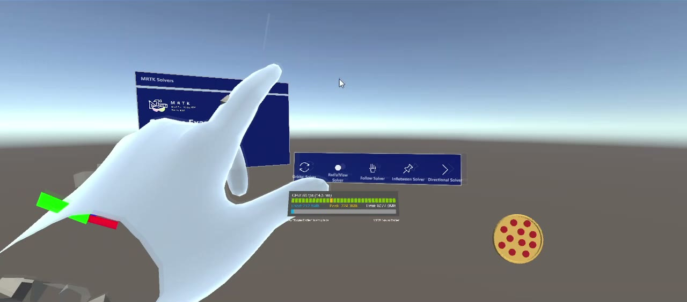

# HoloLens 2 – MRTK Solvers Playground

A small mixed-reality application for **Microsoft HoloLens 2**, built with **Unity** and the
**Mixed Reality Toolkit (MRTK 2)**. It shows how MRTK *solvers* work: components that
automatically position and orient holograms relative to the user's head, hands, hand rays or other
objects.

A **hand menu** attached to the user's left hand switches between five solver demos. A custom 3D
model (a pizza 🍕, modelled in Blender) follows the user's gaze throughout the experience.



▶️ **Demo video:** [`docs/demo.mp4`](docs/demo.mp4) (≈2.5 min, recorded in the Unity editor with
MRTK input simulation)

> Built in May–June 2022 as a hands-on project for learning MRTK.

---

## Features

All demo content lives in a single scene: `Assets/Scenes/IACOBONE_NICOLO.unity`.

### Hand menu (Hand Constraint solver)

- The `HandMenu` object uses MRTK's **`HandConstraint`** solver. It tracks the **left hand** and
  appears next to the thumb side of the hand (radial safe zone).
- It contains five buttons: **Orbital**, **RadialView**, **Follow**, **InBetween** and
  **Directional**. Each button turns one demo group on or off.
- The buttons act like radio buttons: turning one demo on turns the others off. The custom
  [`HandMenuButtonToggle`](holo_lens_2_project/Assets/Utils/Scripts/HandMenuButtonToggle.cs)
  script handles this.
- All demo groups are hidden at start-up.

### Solver demos

| Hand-menu button | Objects | What happens |
|---|---|---|
| **Orbital** | Blue sphere + white sphere | The blue sphere uses an `Orbital` solver bound to the **hand rays** and floats 0.5 m along them. The white sphere uses an `Orbital` solver with a **custom target** (the blue sphere), so it travels around with the blue sphere. |
| **RadialView** | Blue sphere | A **head-locked "tag-along"** object (`RadialView`, 0.5–1 m from the user, at most 10° off the view centre). It always stays close to where the user is looking. |
| **Follow** | Blue sphere + white sphere | Two `Follow` solvers, one on the **left-hand ray** (blue) and one on the **right-hand ray** (white). Each sphere stays 0.3–0.9 m along its ray and turns to face it. |
| **InBetween** | Two blue spheres + one white sphere | The two blue spheres can be grabbed and moved (`ObjectManipulator`; one also supports near grab via `NearInteractionGrabbable`). The white sphere uses an `InBetween` solver to stay **halfway between them**. |
| **Directional** | Red arrow + yellow arrow | Two `DirectionalIndicator` solvers, tracked to the head. When the *Solvers Examples* information panel is out of view, the arrows point toward it. They fade out as it comes back into view. |

### Always-on content

- **Pizza model**: a custom Blender model ([`untitled.blend`](holo_lens_2_project/Assets/Utils/Prefabs/untitled.blend),
  exported as `untitled.obj` / `untitled.mtl` with *Pizza* and *Salame* materials). A
  `RadialView` solver keeps it in the lower-right part of the user's view, 1–2 m away.
- **Information panel**: an MRTK scene-description panel titled *MRTK Solvers* that lists the
  demonstrated solvers.
- **MRTK diagnostics**: the frame-rate and memory profiler from the default MRTK profile.

---

## Tech stack

| Component | Version |
|---|---|
| Unity | **2020.3.20f1** (LTS) |
| Mixed Reality Toolkit – Foundation / Extensions / Examples / Standard Assets | 2.7.3 |
| Mixed Reality Toolkit – Tools / Test Utilities | 2.8.0 |
| Mixed Reality OpenXR Plugin | 1.4.0 |
| Unity OpenXR Plugin | 1.4.2 |
| TextMesh Pro | 3.0.6 |
| Target platform | Universal Windows Platform (HoloLens 2) |

The Microsoft packages were installed with the
[Mixed Reality Feature Tool](https://learn.microsoft.com/windows/mixed-reality/develop/unity/welcome-to-mr-feature-tool).
They are stored as local tarballs in `holo_lens_2_project/Packages/MixedReality/` and referenced
from `Packages/manifest.json`, so the project opens without any extra download step.

---

## Repository structure

```
.
├── docs/
│   ├── demo.mp4                     # compressed demo video
│   └── screenshot.jpg
└── holo_lens_2_project/             # Unity project root (open this folder in Unity Hub)
    ├── Assets/
    │   ├── Scenes/
    │   │   └── IACOBONE_NICOLO.unity    # main (and only) scene
    │   ├── Utils/
    │   │   ├── Materials/               # sphere & arrow materials
    │   │   ├── Prefabs/                 # spheres, arrows, hand menu, pizza model
    │   │   ├── Scripts/
    │   │   │   └── HandMenuButtonToggle.cs
    │   │   └── UnityAssets/PolygonStarter/  # low-poly models (Synty Studios)
    │   ├── MRTK/Shaders/                # shaders copied by MRTK
    │   ├── MixedRealityToolkit.Generated/
    │   ├── TextMesh Pro/                # TMP essential resources
    │   └── XR/                          # OpenXR loader & settings
    ├── Packages/
    │   ├── manifest.json
    │   └── MixedReality/                # MRTK & OpenXR .tgz packages
    └── ProjectSettings/
```

---

## Getting started

### Requirements

- **Unity 2020.3.20f1** with the **Universal Windows Platform Build Support** module
  (the IL2CPP scripting backend is used).
- To deploy to a device: **Windows 10/11** and **Visual Studio 2019/2022** with the
  *Universal Windows Platform development* and *Desktop development with C++* workloads.
- A **HoloLens 2** (optional; you can try everything in the editor).

### Run in the Unity editor

1. Clone the repository and open the `holo_lens_2_project` folder from **Unity Hub**.
   The first import takes a few minutes while Unity rebuilds the `Library` folder.
2. Open `Assets/Scenes/IACOBONE_NICOLO.unity`.
3. Press **Play**. MRTK **input simulation** is turned on in the default profile:

   | Action | Input |
   |---|---|
   | Look around | Hold **right mouse button** and move the mouse |
   | Move | **W A S D**, **Q / E** for down / up |
   | Show left / right hand | Hold **Left Shift** / **Space** |
   | Keep hands visible | **T** (left) / **Y** (right) |
   | Pinch / click | **Left mouse button** while a hand is visible |
   | Rotate a hand | While a hand is shown, hold **Left Ctrl** and move the mouse |

   The hand menu appears next to the simulated **left** hand as soon as that hand is visible.

   Check the *Input Simulation Service* settings in the MRTK profile if your MRTK version uses
   different defaults.

### Build and deploy to HoloLens 2

1. **File ▸ Build Settings**: select **Universal Windows Platform** and click *Switch Platform*.
   - Target Device: *HoloLens*, Architecture: *ARM64*.
2. **Project Settings ▸ Player ▸ Publishing Settings ▸ Certificate**: click **Create** to
   generate a new test signing certificate. Certificates are not committed to the repository
   (see [.gitignore](.gitignore)).
3. **Project Settings ▸ XR Plug-in Management** (UWP tab): make sure **OpenXR** is enabled with
   the **Microsoft HoloLens** feature group.
4. Click **Build** and select an output folder (e.g. `build/`, which is git-ignored).
5. Open the generated `.sln` in Visual Studio. Choose **Release** and **ARM64**, then pick
   **Device** (USB) or **Remote Machine** (Wi-Fi, using the HoloLens IP address). Run
   **Debug ▸ Start Without Debugging**.

---

## Known issues

- **Hand-menu toggle state:** `HandMenuButtonToggle` hides the other demo groups when a button is
  pressed, but it does not reset their internal `isButtonActive` flag. After switching demos, the
  previously active button may need **two presses** to show its demo again.
- The product name in *Player Settings* is still the placeholder `Nico Prova 2`.

---

## Credits & third-party content

- **[Mixed Reality Toolkit for Unity](https://github.com/microsoft/MixedRealityToolkit-Unity)** and
  the **Mixed Reality OpenXR Plugin** © Microsoft Corporation. MRTK is MIT-licensed. The OpenXR
  plugin is distributed under Microsoft's own license terms.
- **POLYGON – Starter Pack** low-poly models © Synty Studios, from the Unity Asset Store. They are
  used under the
  [Unity Asset Store EULA](https://unity.com/legal/as-terms).
- **TextMesh Pro** © Unity Technologies.
- Some helper assets in `Assets/Utils` (the sphere and arrow prefabs, the hand-menu prefab and
  `HandMenuButtonToggle.cs`) are adapted from a public HoloLens 2 / MRTK tutorial series by
  *Dilmer Games* (Dilmer Valecillos).
- Pizza model, scene composition and solver configuration: Nicolò Iacobone.
